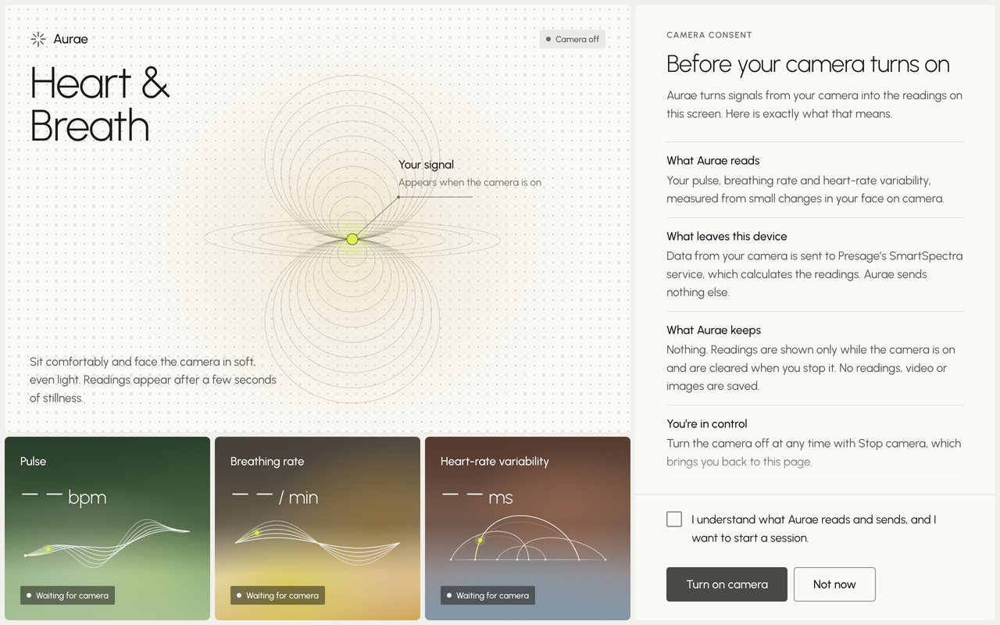

[](https://repoclip.io/v/e3e7457b-7fce-4f38-85c6-c65b8212edaa)

# Aurae

**A calm, camera-based view of your heart and breath.** Sit in front of your camera and Aurae
shows your pulse, breathing rate and heart-rate variability, live, measured by the
[Presage SmartSpectra SDK](https://physiology.presagetech.com) from small changes in your face.
No wearable, and nothing is saved.

Aurae is a desktop app (Electron, Vue 3, TypeScript) built for the
[Presage SmartSpectra SDK Challenge](https://dev.to/challenges/presage-2026-11-04).



> Readings are for reflection and play. They are not medical advice and cannot diagnose anything.

## What it does

- **Asks first.** The camera stays off until you read what Aurae does and tick a consent box.
  "Not now" keeps it off.
- **Live readings.** Pulse (bpm), breathing rate (breaths per minute) and heart-rate variability
  (RMSSD, in ms) update in real time. Each card says whether its reading is _Waiting_,
  _Settling_ or a _Steady signal_, based on the SDK's own stability flag.
- **Guides you.** The SDK's positioning hints (such as holding still, moving closer or finding
  better light) appear under your camera view and are announced to screen readers.
- **A soft camera view.** Your camera feed is shown mirrored, in greyscale and faded at the
  edges, so the screen stays calm rather than clinical.
- **Stops cleanly.** _Stop camera_ releases the camera, clears every reading and returns to the
  consent screen.
- **Plain-language errors.** If the camera can't start, Aurae says why: permission refused, no
  camera, camera in use by another app, API key problem, or no connection.

## Setup

Tested on **macOS (Apple Silicon)**. The SDK also ships native libraries for Windows x64 and
Linux x64/arm64, but Aurae hasn't been tested there.

You need:

- **Node.js 22** or later, and npm
- **A webcam**
- **A SmartSpectra API key**: sign in at [physiology.presagetech.com](https://physiology.presagetech.com)
  and copy your API key. The free trial is enough.

```bash
git clone https://github.com/shreyash015/presage-app-challenge.git
cd presage-app-challenge
npm install

# Add your API key (this file is git-ignored)
cp .env.example .env.local
# then open .env.local and replace your_key_here with your key:
# RENDERER_VITE_SMARTSPECTRA_API_KEY=<your key>

npm run dev
```

The first time you turn on the camera, macOS asks for camera permission. If you said no earlier,
allow it in **System Settings › Privacy & Security › Camera** (for the app you ran `npm run dev`
from, such as Terminal or VS Code), then try again.

If the key is missing or wrong, Aurae shows "Aurae couldn't sign in to the SmartSpectra
service…". Check `.env.local` and restart `npm run dev`.

### Other commands

| Command             | What it does                                            |
| ------------------- | ------------------------------------------------------- |
| `npm run dev`       | Run the app with live reload                            |
| `npm run lint`      | ESLint                                                  |
| `npm run typecheck` | TypeScript checks for the main process and the renderer |
| `npm run build:mac` | Build a macOS `.dmg` (also `build:win`, `build:linux`)  |

Built apps aren't code-signed. On macOS, open one the first time with right-click › **Open**.
The API key is compiled into a built app, so only share builds made with a key you're happy to
share.

## How it uses SmartSpectra

The SDK runs in two halves: the renderer owns the camera, and the main process runs the native
SmartSpectra engine. They talk over a message port the SDK sets up.

| File                                                                                             | Role                                                                                                                                                                                                                                                                             |
| ------------------------------------------------------------------------------------------------ | -------------------------------------------------------------------------------------------------------------------------------------------------------------------------------------------------------------------------------------------------------------------------------- |
| [`src/renderer/src/composables/useVitals.ts`](src/renderer/src/composables/useVitals.ts)         | Creates `SmartSpectraSDK` with only the three metrics Aurae shows (`PULSE_RATE`, `BREATHING_RATE`, `HRV`) and **telemetry off**. Decodes each `metrics` event with `decodeMetrics`, keeps the latest value and its `stable` flag, and passes `validationStatus` hints to the UI. |
| [`src/main/index.ts`](src/main/index.ts)                                                         | Calls `bindSmartSpectraIpc(window)`, which runs the native engine for the window. On quit it waits for the SDK's native teardown to finish, so the app never crashes on exit.                                                                                                    |
| [`src/main/nativeRuntime.ts`](src/main/nativeRuntime.ts)                                         | In a packaged app, points the SDK at its native library, shipped beside the app archive as the SDK's README describes ([`electron-builder.yml`](electron-builder.yml)).                                                                                                          |
| [`src/preload/index.ts`](src/preload/index.ts)                                                   | Loads the SDK's preload bridge.                                                                                                                                                                                                                                                  |
| [`src/renderer/src/composables/errorMessages.ts`](src/renderer/src/composables/errorMessages.ts) | Turns camera errors and SDK error codes into plain-language messages.                                                                                                                                                                                                            |
| [`src/renderer/src/App.vue`](src/renderer/src/App.vue)                                           | Switches between the consent screen and the session. The camera only starts from the consent screen's _Turn on camera_.                                                                                                                                                          |

The screens are [`ConsentScreen.vue`](src/renderer/src/components/ConsentScreen.vue) and
[`SessionScreen.vue`](src/renderer/src/components/SessionScreen.vue); the reading cards are
[`AtmosCard.vue`](src/renderer/src/components/AtmosCard.vue).

## Privacy and consent

- **Consent:** the camera never turns on until you tick the consent box and press _Turn on
  camera_. The consent screen explains what is read, what is sent and what is kept, in plain
  language. The OS camera permission is requested separately, and the app only grants camera
  access to its own page.
- **What is sent:** data from your camera goes to Presage's SmartSpectra service, which
  calculates the readings. Aurae sends nothing else.
- **Telemetry:** SmartSpectra's usage telemetry is **turned off** (`enableTelemetry: false`).
- **Storage and retention:** none. Readings exist only on screen while the camera is on and are
  cleared when you stop it. No readings, video or images are saved, and there is nothing to
  delete.
- **No AI services** and no analytics are used.
- **Not medical:** Aurae makes no diagnosis or treatment claims and isn't for medical decisions.

## Credits

- [Presage SmartSpectra SDK](https://physiology.presagetech.com) (`@smartspectra/node-sdk`)
  for all vital-sign measurement. The SDK is proprietary, under Presage's own licence.
- [electron-vite](https://electron-vite.org), [Vue 3](https://vuejs.org),
  [motion-v](https://motion.dev/docs/vue) for animation and the
  [Urbanist](https://fonts.google.com/specimen/Urbanist) typeface.

## Licence

Aurae's own code is released under the [MIT License](LICENSE). The SmartSpectra SDK it depends
on is not covered by this licence: it is proprietary software from Presage Technologies, under
Presage's own terms.
