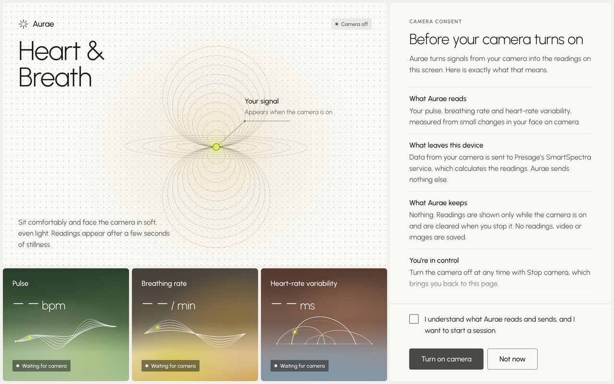

<!--
  DRAFT. Before publishing:
  1. Replace every [[ ... ]] with your own words or links.
  2. Push the repo to master first, so the screenshot link below works (or upload it in DEV's editor).
  3. Delete these comment blocks if you like (DEV hides them anyway).
-->

_This is a submission for the [Presage SmartSpectra SDK Challenge](https://dev.to/challenges/presage-2026-11-04)_

## What I Built

**Aurae** is a desktop app that gives you a quiet moment to check in with your body. Sit in
front of your webcam and Aurae shows your **pulse**, **breathing rate** and **heart-rate
variability**, live, measured by the Presage SmartSpectra SDK from tiny changes in your face.
No wearable, and nothing is saved.

Most health apps look like a hospital monitor: red numbers, alarms, charts that make you more
anxious, not less. I wanted the opposite: a warm, slow, almost paper-like screen that treats
your readings as something to reflect on, not something to worry about. Aurae is explicitly
**not** a medical tool. It says so on every screen.

What it does:

- **Asks before anything happens.** The camera stays off until you've read what Aurae reads,
  sends and keeps, and ticked a consent box. "Not now" really means not now.
- **Shows three live readings**, each with an honest status: _Waiting for a reading_,
  _Settling_ or _Steady signal_.
- **Guides you** with the SDK's own positioning hints, such as holding still, moving closer or
  finding better light.
- **Keeps the camera view soft**: mirrored, greyscale and faded at the edges, so you're not
  staring at a harsh video of yourself.
- **Stops cleanly.** One button releases the camera, clears every reading and takes you back to
  the start.

## Demo



The video shows the consent screen, turning on the camera, the live readings settling into a
steady signal, and stopping the camera.

## Code



Setup takes a few minutes: clone, `npm install`, put your SmartSpectra API key in `.env.local`
and run `npm run dev`. Full instructions are in the README.

I built Aurae with **Claude Code** as a pair programmer: design prototypes, accessibility and UX
audits with Playwright, the SDK integration, and tracking down the quit crash and the packaging
bug.

## How It Responds to Human Signals

Aurae uses three live Presage signals: **pulse rate**, **breathing rate** and **heart-rate
variability** (RMSSD). As the SDK streams new values, the experience responds in real time:

- **The readings update live** on three cards: pulse in bpm, breathing in breaths per minute,
  HRV in milliseconds.
- **Each card shows how much to trust its number.** The SDK marks every reading as stable or
  not, and Aurae turns that into a plain status chip: _Waiting for a reading_, then
  _Settling_, then _Steady signal_. You know when to just breathe and wait.
- **The screen coaches you.** The SDK's validation hints (face not centred, too dark, too much
  movement and so on) appear in plain words under your camera view, and screen readers announce
  them.
- **Problems are explained, not hidden.** Camera errors and SDK error codes become specific
  messages: camera permission refused, camera in use by another app, API key problem, no
  connection.

### How I integrated the SmartSpectra SDK

Aurae is built with Electron, Vue 3 and TypeScript, using `@smartspectra/node-sdk`. The SDK
splits into two halves, and so does the app:

- **Renderer (the UI).** A Vue composable,
  [`useVitals.ts`](https://github.com/shreyash015/presage-app-challenge/blob/master/src/renderer/src/composables/useVitals.ts),
  creates `SmartSpectraSDK` and asks for **only the three metrics Aurae shows**
  (`PULSE_RATE`, `BREATHING_RATE`, `HRV`), with **telemetry turned off**. It listens for
  `metrics` events, decodes each protobuf payload with `decodeMetrics`, and keeps the latest
  value plus its `stable` flag in reactive state. It also listens for `validationStatus` hints
  and `error` events.
- **Main process (the native engine).** `bindSmartSpectraIpc(window)` connects the window to the
  native SmartSpectra engine over a message port. The SDK's preload bridge sets that port up.

Requesting only three metrics mattered. My first version asked for the SDK's full cardio and
breathing groups (11 metric types). That also pulled in a model Aurae never uses, fetched
remotely at start-up, plus metrics I'd have had to disclose but didn't show.

Two things I had to solve along the way:

1. **A crash on quit.** If you quit while the SDK was (or had been) running, the native engine
   finished tearing down on a worker thread _after_ Node had started shutting down, and the
   app aborted. Aurae now waits for every SDK teardown to finish before it exits. I verified
   this with Playwright tests that quit in different ways.
2. **Packaging.** In a packaged Electron app, the SDK's native library ended up inside the
   `app.asar` archive, where macOS can't load it, so the app couldn't start. Following the SDK
   README's packaging guidance, the native folder now ships next to the archive, and the app
   points the SDK at it with the documented `SMARTSPECTRA_CAPI_PATH` setting. As a bonus, each
   platform's build only includes its own native libraries, which took the macOS app from
   625 MB to 417 MB.

## Prize Categories

**Best Thoughtful Real-World Use**

<!-- Optional: also enter "Most Creative or Delightful Use" by adding a short paragraph about
     what makes Aurae original or playful (the design language, the atmospheric cards). -->

**The need:** Checking in with your
body during a stressful day usually means a smartwatch, or an app that makes your heart rate
feel like a warning sign. Aurae needs nothing but the webcam you already have. It turns
"how am I doing?" into a calm, thirty-second pause.

**Who it's for:** people who want a moment of awareness, not a diagnosis. For example, someone
who wants to see their breathing slow down after a hard meeting, or anyone curious about what
their camera can sense, who'd rather not wear a device.

**How I designed it to be usable for them:**

- **Calm by default.** Warm, paper-like colours; slow, gentle motion; no red numbers, alarms or
  scores. Readings come with "Settling" and "Steady signal", never "good" or "bad".
- **Plain language everywhere.** The consent screen explains in four short sections what Aurae
  reads, what leaves the device, what it keeps and how to stop. Errors say what happened and
  what to do.
- **Accessible.** Hints and errors are announced to screen readers. Animations respect the
  system's "reduce motion" setting. Layouts reserve space so nothing jumps when messages appear.
  The design adapts from a phone-sized window up to a wide desktop.
- **In control.** One clear button turns the camera off at any time. Nothing carries over
  between sessions.

## Consent and Data Handling

- **Camera consent.** The camera never turns on automatically. Aurae opens on a consent screen
  that explains, in plain language, what it reads (pulse, breathing rate, heart-rate
  variability), what leaves the device, and what it keeps. You must tick a consent box and press
  _Turn on camera_. "Not now" keeps the camera off. macOS then asks for its own camera
  permission, and the app only grants camera access to its own page, nothing else.
- **What is shared.** Data from the camera is sent to Presage's SmartSpectra service, which
  calculates the readings. Aurae sends nothing else.
- **SDK telemetry.** **Off.** Aurae sets `enableTelemetry: false`, so the SDK doesn't send
  Presage usage statistics.
- **Storage and retention.** **None.** Readings exist only on screen while the camera is on and
  are cleared as soon as you stop it. Aurae saves no readings, video or images to disk, and has no history,
  accounts or analytics.
- **Deletion.** There is nothing stored to delete. Stopping the camera or closing the app clears
  everything.
- **AI services.** None. Aurae doesn't use the SDK's optional AI features or any other AI
  service.
- **No medical claims.** Every screen says: _"Readings are for reflection and play. They are not
  medical advice and cannot diagnose anything."_ Aurae makes no diagnosis or treatment claims and
  isn't for medical decisions.

<!-- Cover image idea: the consent-screen screenshot, or the Aurae icon (build/icon.png). -->
